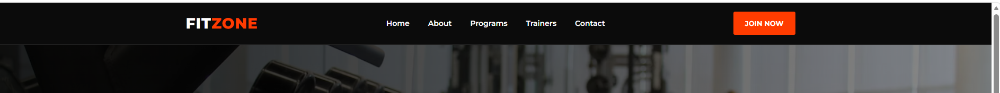
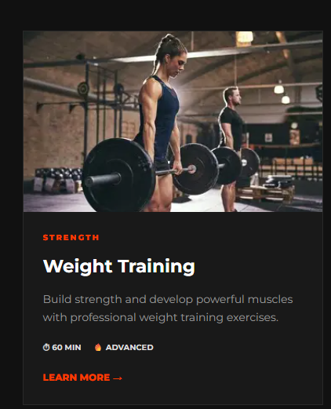
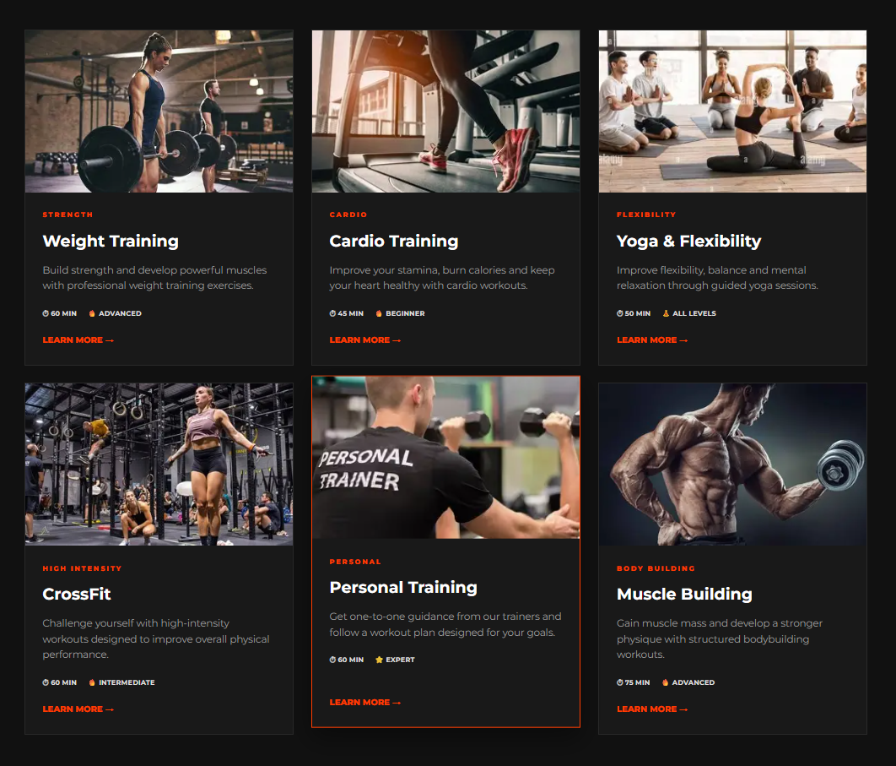
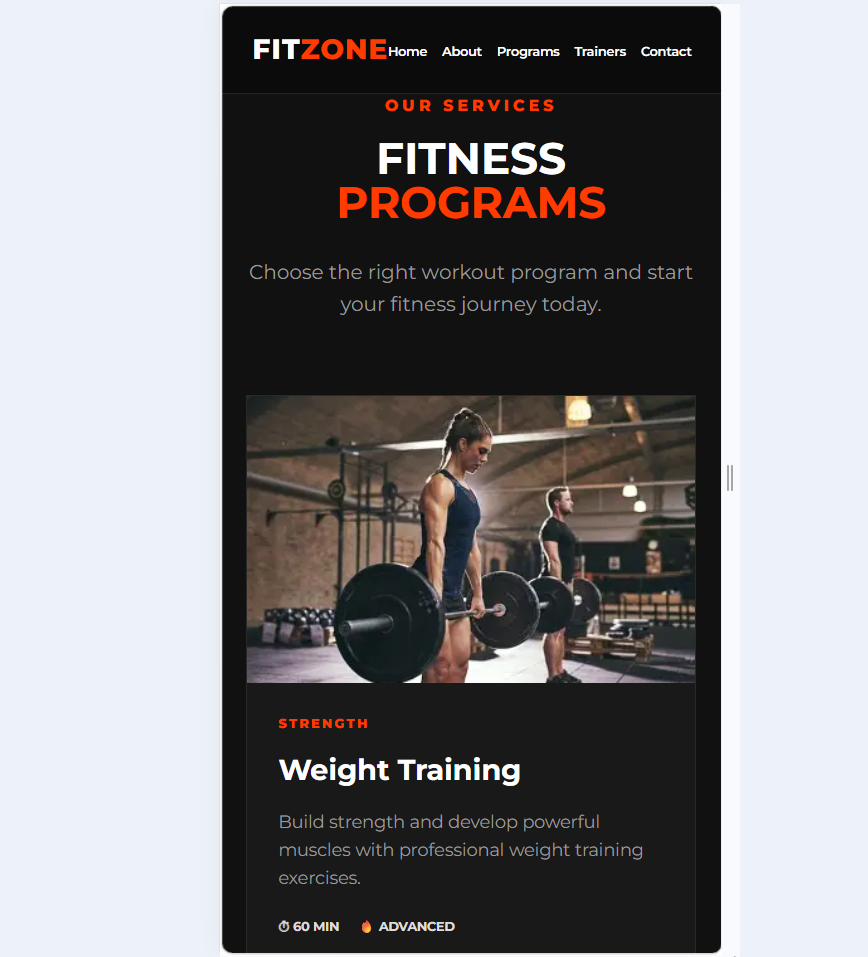

# FITZONE — Gym & Fitness Website

## 1. Assignment Title

**HTML & CSS — Navigation Bar and Card Design**

### Project Theme

**Gym & Fitness Website — FITZONE**

---

## 2. Student Information

| Information          | Details                                   |
| -------------------- | ----------------------------------------- |
| **Name**             | Riyana Kumal                              |
| **Student ID**       | Add your Student ID                       |
| **Course/Module**    | FSE                                       |
| **Level**            | Add your Level                            |
| **Assignment Title** | HTML & CSS Navigation Bar and Card Design |

---

## 3. Project Description

FITZONE is a modern Gym & Fitness website created using HTML and CSS.

The website is designed to provide information about different fitness programs and encourage users to start their fitness journey.

The website includes:

* Professional navigation bar
* Hero section
* About section
* Fitness programs
* Six fitness cards
* Professional trainers section
* Contact section
* Footer
* Hover effects
* Responsive design

The six fitness programs included in the website are:

1. Weight Training
2. Cardio Training
3. Yoga & Flexibility
4. CrossFit
5. Personal Training
6. Muscle Building

The website is designed to work on desktop, tablet and mobile screen sizes.

---

## 4. Technologies Used

The following technologies were used to develop this project:

* **HTML5**
* **CSS3**
* **CSS Flexbox**
* **CSS Grid**
* **Responsive CSS**
* **Google Fonts**
* **Unsplash Images**

---

## 5. Website Features

### Navigation Bar

The navigation bar contains:

* FITZONE logo
* Home
* About
* Programs
* Trainers
* Contact
* Join Now button

CSS hover effects are applied to the navigation links.

### Hero Section

The hero section introduces the FITZONE gym with:

* Main heading
* Short description
* Explore Programs button
* Contact Us button
* Background fitness image

### About Section

The About section explains the purpose of FITZONE and includes a gym image and information about the fitness center.

### Fitness Programs

The website contains six fitness program cards.

Each card includes:

* Fitness image
* Category/tag
* Program title
* Description
* Workout duration
* Difficulty level
* Learn More button

### Responsive Design

The card layout changes depending on screen size:

* **Desktop:** 3 cards per row
* **Tablet:** 2 cards per row
* **Mobile:** 1 card per row


## 6. Screenshots

Screenshots of the completed project are included in the `screenshots` folder.

### Navigation Bar



### Card Design



### Card Layout



### Responsive Design



---

## 7. Key Concepts Learned

### Semantic HTML

I learned that semantic HTML elements describe the purpose of different parts of a webpage.

For example:

```html
<header>
<nav>
<main>
<section>
<article>
<footer>
```

I used these elements to make the structure of my website clear.

### CSS Selectors

I learned how selectors are used to target HTML elements and apply styles.

Examples used in the project include:

```css
body
.navbar
.nav-links a
.fitness-card
.card-content h3
```

### Box Model

I learned that the CSS box model consists of:

* Content
* Padding
* Border
* Margin

I used padding and margin to create proper spacing throughout the website.

### Flexbox

I used Flexbox for the navigation bar.

For example:

```css
.navbar {
    display: flex;
    align-items: center;
    justify-content: space-between;
}
```

This helped me align the logo, navigation links and button.

### CSS Grid

I used CSS Grid for the fitness cards.

```css
.card-container {
    display: grid;
    grid-template-columns: repeat(3, 1fr);
}
```

This allowed me to create three cards per row on larger screens.

### Hover Effects

I added hover effects to navigation links, buttons and cards.

For example:

```css
.fitness-card:hover {
    transform: translateY(-10px);
}
```

This makes the card move slightly upward when the user places the mouse over it.

### Responsive Design

I used media queries to make the website responsive.

For example:

```css
@media (max-width: 600px) {
    .card-container {
        grid-template-columns: 1fr;
    }
}
```

This changes the cards to one column on smaller screens.

---

## 9. Challenges and Solutions

### Challenge 1 — Creating the Card Layout

Initially, it was difficult to arrange six cards properly and maintain consistent spacing.

**Solution:**

I learned about CSS Grid and used:

```css
display: grid;
grid-template-columns: repeat(3, 1fr);
gap: 25px;
```

This helped me create an organized card layout.

### Challenge 2 — Making the Website Responsive

Another challenge was making the website work properly on mobile screens.

**Solution:**

I used CSS media queries to change the number of columns depending on the screen size.

The layout changes from:

**Desktop → 3 cards**

**Tablet → 2 cards**

**Mobile → 1 card**

### Challenge 3 — Creating Hover Effects

I wanted the cards and buttons to respond when the user moves the mouse over them.

**Solution:**

I used CSS `:hover` and `transition` properties to create smooth effects.

---

## 10. Project Structure

```text
gym-fitness/
│
├── index.html
│
├── css/
│   └── style.css
│
├── images/
│   └── ...
│
├── screenshots/
│   ├── navigation-bar.png
│   ├── card-design.png
│   ├── card-layout.png
│   └── responsive-design.png
│
└── README.md
```

---

## 11. AI Usage Disclosure

I used **ChatGPT** as an AI learning assistant during the development of this project.

AI assistance was used for:

* Understanding HTML and CSS concepts
* Getting guidance about webpage structure
* Understanding responsive design
* Getting suggestions for CSS layout
* Troubleshooting and improving the code

I reviewed and modified the code and am responsible for understanding how the implementation works.

---

## 12. Conclusion

The FITZONE Gym & Fitness website helped me practice important HTML and CSS concepts.

Through this project, I learned how to:

* Create a semantic HTML structure
* Build a professional navigation bar
* Design reusable cards
* Use Flexbox
* Use CSS Grid
* Apply hover effects
* Use responsive media queries
* Organize a complete webpage
* Create documentation using README.md

This project improved my understanding of how HTML and CSS can be combined to create a professional and responsive website.

---

## 13. GitHub Repository

**GitHub Repository:**
Add your GitHub repository URL here.

Example:

```text
https://github.com/riyanaa/gym-fitness
```

---

## 14. Final Checklist

* [x] Navigation bar completed
* [x] Navigation hover effects added
* [x] Six fitness cards created
* [x] Images added
* [x] Card hover effects added
* [x] CSS Grid used
* [x] Flexbox used
* [x] Responsive design implemented
* [ ] Navigation screenshot added
* [ ] Card design screenshot added
* [ ] Card layout screenshot added
* [ ] Responsive screenshot added
* [x] README.md created
* [x] AI usage disclosed
* [ ] GitHub repository link added
